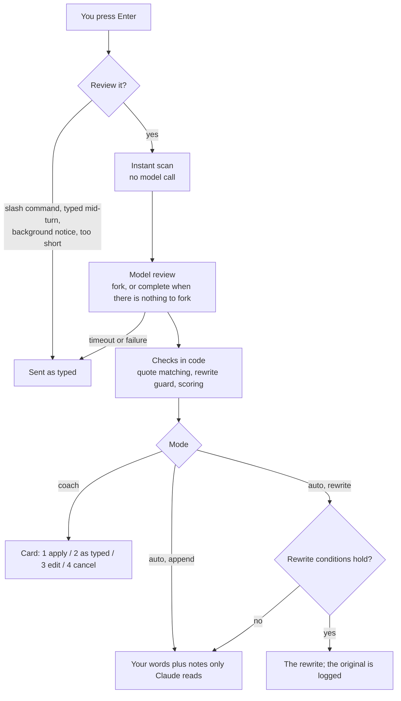

<p align="center"><a href="README.md">繁體中文</a> · <b>English</b></p>

<h1 align="center">Prompt Coach</h1>

<p align="center">
  A Claude Code mod. After you press Enter and before Claude reads your prompt, it checks the prompt against Anthropic's prompting guidance.<br>
  The rules depend on the model and effort level your session is running. It can show you the review and let you choose, or apply it on its own.
</p>

## Let an AI install it

Paste this into Claude Code:

```text
Please install the Claude Code plugin Prompt Coach.
1. First ask me which interface language I want, and wait for my answer: English, or Traditional Chinese (正體中文).
2. Run: claude plugin marketplace add Sen-CaPoo/prompt-coach
3. For English install prompt-coach-en; for Traditional Chinese install prompt-coach:
   claude plugin install <plugin name>@prompt-coach
4. Run claude plugin list. If the other language's build is installed too, remove it with claude plugin uninstall <other plugin name>@prompt-coach; with both installed, every prompt is reviewed twice.
5. Tell me the result and remind me to run /reload-plugins in Claude Code, or to restart it.
6. In a sentence or two, in the language I chose, say what /prompt-coach status, /prompt-coach auto and /prompt-coach off do.
Do not change any other setting.
```

## Install it yourself

The interface language comes with the build you install. Install one of the two:

| Build | Plugin name | Interface |
| --- | --- | --- |
| English | `prompt-coach-en` | The card, the notes, the command output and the settings screens are all in English |
| Traditional Chinese | `prompt-coach` | The same, all in Traditional Chinese |

| Step | Type in Claude Code | What you should see |
| --- | --- | --- |
| 1 | `/plugin marketplace add Sen-CaPoo/prompt-coach` | The marketplace is added |
| 2 | `/plugin install prompt-coach-en@prompt-coach` (Traditional Chinese: `prompt-coach@prompt-coach`) | `Installed prompt-coach-en` (or `prompt-coach`) |
| 3 | `/reload-plugins` | `/prompt-coach status` reports the current mode |

To switch languages, `/plugin uninstall` the build you have and install the other. The two keep their settings apart, so set them again after switching.

Requires Claude Code 2.1.287 or later. Tested on 2.1.322 (Windows).

To try it without installing, clone this repository, run `node scripts/manifest.mjs en` in the folder to write a `plugin.json` (leave out `en` for Traditional Chinese), and start `claude --plugin-dir <folder>`; it applies to that session only.

## Two modes

| | Coach (default) | Auto |
| --- | --- | --- |
| What it does | Shows a card when the score is under the pass score; you decide how to send | Handles the prompt and sends it without asking |
| Your prompt | Replaced only if you pick the suggested version | **append** (default): not one character changes, and the notes are read by Claude alone. **rewrite**: replaced by the rewritten version when [the conditions](#when-a-rewrite-is-applied-without-asking) hold; otherwise handled as append |
| What it leaves | The card | Dim rows in the transcript: what was attached, or what you originally typed |
| Switch | `/prompt-coach coach` | `/prompt-coach append` or `/prompt-coach rewrite` |

The card in coach mode (choose with a digit key):

```text
Prompt Coach · Sonnet 5.5 · effort medium · score 25 (1 of 5 checks passed)
1: Use the suggested version  2: Send as typed  3: Put it back to edit  4: Cancel  Esc cancels too

Reference: "the login thing" names no file; the conversation mentioned src/components/LoginForm.tsx.
Done criteria: nothing says what counts as done; npm test -- LoginForm came up earlier.
Missing info: the wording and placement of the error message, which only you know.
Suggested version
- fix the login thing
+ Fix src/components/LoginForm.tsx so that a 401 from the API shows an error message. Then run
  npm test -- LoginForm. If the wording or placement of the message is unclear, ask me first.
```

Which auto style to pick:

- **append** suits most people. Your own words stay as the evidence of what you meant; the notes only carry over what the conversation already settled.
- **rewrite** suits people whose prompts tend to be very short. It carries more risk: afterwards the transcript and the prompt history hold only the rewritten text, so the original is logged in the transcript every time.
- Neither style answers what only you know. Missing information becomes a line telling Claude to ask first if it affects the approach.

### When a rewrite is applied without asking

Replacing your words with nobody looking is where a mistake costs most, so the conditions are narrow on purpose. All of them must hold; otherwise the prompt is handled as append, and `/prompt-coach last` says why.

| Condition | What falls outside it |
| --- | --- |
| It is a task, and at least one check failed | A question, an exploration, a prompt that is already clear |
| It is not a go-ahead | "ok, go ahead with your plan", "use the second option" |
| It sets no limit, condition or order of steps | "don't touch session.ts", "only the login page", "read the log first, then fix it" |
| At most 600 characters and 5 lines, with no code block and no pasted code or log | A prompt with a pasted error message |
| The rewrite brings in no risky action you did not mention | The rewrite says delete, deploy or push and your prompt did not |

For a prompt with limits or conditions, use coach mode and press 1 after reading the suggested version.

## Commands

| Command | Effect |
| --- | --- |
| `/prompt-coach` or `/prompt-coach status` | Mode, review engine, model and effort |
| `/prompt-coach coach` | Coach mode for this session |
| `/prompt-coach auto` | Auto mode for this session, with the current style |
| `/prompt-coach append` / `rewrite` | Auto mode with that style |
| `/prompt-coach off` | Off for this session |
| `/prompt-coach last` | The last review in full: every check, every suggestion, and why a rewrite was not used |

Commands last for the session (one entry per session in the plugin's store, so they survive `/reload-plugins`). To change the defaults, run `/plugin configure prompt-coach-en@prompt-coach` (`prompt-coach@prompt-coach` for the Traditional Chinese build), or edit them in `/config`.

## Options

Both builds have the same options and defaults; only the language of the names and descriptions differs. Each description ends with the default, and an option left unset takes its default.

| Option | Default | Meaning |
| --- | --- | --- |
| `mode` | `coach` | `coach`, `auto` or `off` |
| `auto_style` | `append` | `append` or `rewrite` |
| `pass_score` | `85` | In coach mode, a prompt scoring at least this is sent without asking |
| `backend` | `session` | `session`: Claude Code's own connection (your plan, API key or cloud provider). `api_key`: the Messages API with the key below |
| `engine` | `fork` | `fork`: the session's model reviews with the whole conversation in view, reusing its prompt cache. `complete`: a separate call that sees a digest |
| `fork_effort` | `low` | `low`: a fork review asks for low effort, the quickest. `session`: it names no level and runs at the session's; choose this when your model or provider takes effort for a whole request only, where a different level writes the conversation to the prompt cache again on every review |
| `review_model` | `session` | Model for `complete` and `api_key`: `session`, `haiku`, `sonnet`, `opus`, `fable` or a full model id |
| `api_key` | empty | Used by the `api_key` backend only. The `PROMPT_COACH_API_KEY` environment variable works too |
| `api_base_url` | `https://api.anthropic.com` | Where the `api_key` backend sends requests |
| `timeout_seconds` | `25` | A review slower than this sends the prompt as typed |
| `min_chars` | `8` | Shorter prompts skip the model review |
| `fork_max_tokens` | `200000` | Past this conversation size the review uses `complete`, so its cost stops growing with the conversation |
| `headless` | `false` | Also review prompts from `claude -p` and the SDK |

## How it works



The reviewer reports each check as pass, fail or not applicable, and the code adds up the score from fixed weights. Asked for an overall impression, models scored the same prompt anywhere from 8 to 35.

| Check | Looks for | Weight |
| --- | --- | --- |
| Goal | What to do, or what answer is wanted | 25 |
| Done criteria | What counts as finished, or how to check it | 25 |
| Reference | "that", "the part above" points at one thing in the conversation | 20 |
| Scope | For a change, what may change and what must not | 15 |
| Missing info | Nothing only you know, and that would change the approach, is left out | 15 |

Questions and exploratory prompts are not held to these checks. The review also looks for wording Anthropic's prompt-audit guide lists as dated, such as shouted emphasis, "think step by step", "don't overthink", asking for the reasoning to be written out, and hard word caps. Each costs 5 or 8 points by confidence.

## Guards

Rewriters add things. In development, every review route produced a rewrite that added a requirement or a limit the person never stated. So these are enforced in code, not by instructions to the model.

| Guard | How |
| --- | --- |
| Notes need a source | Each note must quote the conversation, and the quote has to be there: in what you and Claude said, or in a command Claude ran. A file or command the note names must be in its own quote or in your prompt, or the note is dropped |
| Tool output is not a source | A fetched page or a file's contents is data. Nothing in it counts as said in the conversation, so it cannot back a note or a rewrite |
| A note cannot approve for you | An ask-first note may only point at what is missing. One that says "already agreed" or "no need to ask", or that brings up a risky action your prompt did not mention, is dropped |
| A rewrite must lose nothing | Numbers, paths, file names, URLs, `@file` mentions and quoted strings are matched as whole tokens (`5` is not kept by `15`, nor `session.ts` by `mysession.ts`). Code blocks and pasted lines of code or log must appear exactly, indentation included. If one is missing the rewrite is not used |
| A limit cannot change meaning | A clause that sets a limit or a condition ("don't touch X", "ask me before deploying", "only Y") must survive whole, with nothing tacked on, so "don't touch X" cannot become "don't touch anything but X" |
| A rewrite cannot make things up | A rewrite that names a file, command, flag, URL or risky action found in neither your prompt nor the conversation is not used |
| Long prompts are not rewritten | Past 1500 characters or 20 lines a prompt gets notes only. Pasted content reaches the hook unmarked, so nothing can guarantee a rewrite carries it intact |
| A go-ahead is never expanded for you | Claude Code's permission classifier reads your messages as your approvals. Expanding "continue" or "ok, go ahead with your plan" into named actions would approve them on your behalf, so that happens only in coach mode, with your say-so |
| A prompt cannot instruct the reviewer | Your prompt sits between markers generated afresh for each review, so text inside it cannot forge the closing marker to slip instructions to the reviewer |
| Failure lets the prompt through | A timeout, an error, or a reply that is unreadable or incomplete sends the prompt as typed |
| History is left alone | Only the prompt not yet sent is touched: never the system prompt, never an earlier message |

These guards err toward refusing: a refused rewrite falls back to append, and your own words go out as typed. In practice a prompt that sets limits rarely gets a rewrite, and mostly gets notes.

## Supported models

Opus 5.5, Fable 5.2, Sonnet 5.5 and Haiku 5.5 each have a rule module. Any other model gets the general rules, and the card says so.

The same wording can call for opposite advice on different models. "Finish the whole task" is named for removal on Sonnet 5.5 and is useful on Fable 5.2 at low effort; verification instructions are removed on Opus 5.5 and wanted on Sonnet 5.5 and Haiku 5.5 at low effort. So there are no global rules: everything is judged by model and effort together.

### Adding a model

| Step | What to do |
| --- | --- |
| 1 | Copy the closest module in `rules/` and name it after the new model id, such as `rules/claude-opus-6.ts` |
| 2 | Rewrite `notes` and `effortGuide` from the new model's prompting page, and update `matches`, `sources` and `verified` |
| 3 | Add it to `PROFILES` in `rules/index.ts` |
| 4 | Run `claude plugin test .`; one test checks that every module is complete |

## Development

Each build's manifest is one of the two entries in `.claude-plugin/marketplace.json` (`strict: false`). The repository commits no `plugin.json`: when the folder holds one, Claude Code reads it instead, and both builds would get the same settings screens. Write one before testing locally:

```bash
node scripts/manifest.mjs       # plugin.json for the Traditional Chinese build (English: node scripts/manifest.mjs en); also checks the builds differ in words only
claude plugin validate .        # manifest and hooks
claude plugin test .            # 87 tests, run as the Traditional Chinese build
claude --plugin-dir .           # load this folder (the types are written on first load)
npx -p typescript tsc -p .      # type check
claude --debug                  # each review leaves a line: [prompt-coach] reviewed ...
```

Change an option in both entries at once; `manifest.mjs` stops when their defaults, choices or ranges disagree. Both builds load `hooks/register.tsx` through `hooks/hooks.json`, and the hooks they share are in `hooks/coach.tsx`; each hook picks the language from the plugin's name. A marketplace entry cannot name a hooks file of its own: Claude Code (2.1.322) installs the plugin but refuses to load it.

## Limits

- Each reviewed prompt waits a few seconds and costs one more model call; on a subscription it counts toward your plan's usage. Measured on 2.1.322 with Sonnet 5.5 and Haiku 5.5 over a first-party connection: a fork takes about 3 to 8 seconds, reads the whole conversation from the prompt cache each time, sends about 4,000 tokens of review instructions outside the cache, and writes 300 to 1,400 tokens of output.
- The first fork review of a session sometimes writes the conversation to the cache once more (about 40,000 tokens when measured, while plugins and MCP servers were still loading at startup); after that it only reads. What happens once the cache has expired was not measured.
- A review that times out sends the prompt as typed, but the fork request already made cannot be cancelled from a mod and may still count toward usage.
- The card was tested in the terminal (the pane, and the band above the prompt). Where another surface has no room for a pane, Claude Code's own question dialog asks instead; that path has unit tests only and was not tried in VS Code or on mobile. Where there is no interface (`claude -p`, the SDK) coach mode lets the prompt through; auto mode needs no interface and works as usual.
- A prompt typed while a turn is running is not reviewed. A prompt sent while a review is under way is queued by Claude Code, so two prompts are never reviewed at once.
- After a full rewrite, whether Claude Code's marking of pasted content survives cannot be confirmed from the mod's side. Use append if that matters to you.
- The `api_key` backend was verified for its request format and for failing open, not for a successful call with a real key.
- The build sets the language of the settings screens; no option switches it. `/plugin configure`, the settings screen at install and `/config` all read that build's manifest (tested in the terminal on 2.1.322: each build shows one language only).
- In the `/plugin configure` and install forms, a number or text field never set is blank rather than showing its default; that is how Claude Code draws the form. The default still applies, and the `/config` list shows it. That is why each description ends with the default.
- With both builds installed, every prompt is reviewed twice, and both register `/prompt-coach`. Install one.
- After `--resume` into the same session, a mode switched with `/prompt-coach` may still hold.
- The mod API can change between Claude Code releases. After an update, run `claude plugin validate .` and `claude plugin test .`.
- An organization that sets `allowManagedModsOnly` in managed settings stops mods its users install themselves.

## Sources

- [Prompting best practices](https://platform.claude.com/docs/en/build-with-claude/prompt-engineering/claude-prompting-best-practices) and the model pages for [Opus 5.5](https://platform.claude.com/docs/en/build-with-claude/prompt-engineering/prompting-claude-opus-5-5), [Fable 5.2](https://platform.claude.com/docs/en/build-with-claude/prompt-engineering/prompting-claude-fable-5-2), [Sonnet 5.5](https://platform.claude.com/docs/en/build-with-claude/prompt-engineering/prompting-claude-sonnet-5-5) and [Haiku 5.5](https://platform.claude.com/docs/en/build-with-claude/prompt-engineering/prompting-claude-haiku-5-5)
- `prompt-audit.md` and `model-migration.md` in Claude Code's bundled claude-api skill
- [Claude Code mods](https://code.claude.com/docs/en/plugins/mods/overview), [Model configuration](https://code.claude.com/docs/en/model-config), [Best practices](https://code.claude.com/docs/en/best-practices)
- [claude.dev](https://claude.dev/): Getting started with Claude Code mods, Spending your effort, Which Claude model should you build with?
- The way it waits for a decision follows Anthropic's example mod [Blast Radius](https://github.com/anthropics/claude-code-playground/tree/main/claude-code/mods/blast-radius)

Rules last checked against these sources: 2026-11-11.

## License

MIT
