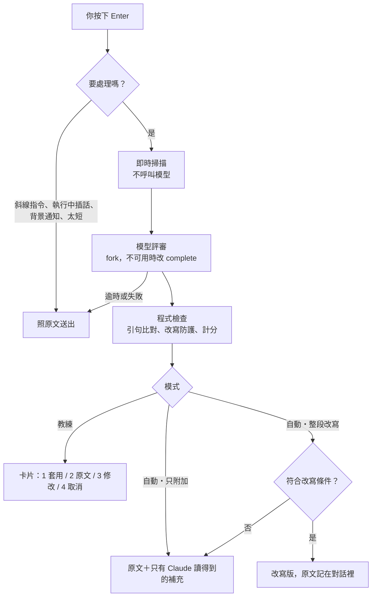

<p align="center"><b>繁體中文</b> · <a href="README.en.md">English</a></p>

<h1 align="center">提示詞教練 Prompt Coach</h1>

<p align="center">
  Claude Code 的 mod：你按下 Enter 之後、Claude 讀到之前，先依 Anthropic 官方的提示詞指引檢查這則 prompt。<br>
  規則依你目前使用的模型與 effort 而定。可以讓你看過再決定，也可以全自動。
</p>

<p align="center">
  
  
  
</p>

## 交給 AI 安裝

不想自己動手的話，把下面這段貼給 Claude Code，它會幫你裝好：

```text
請幫我安裝 Claude Code 外掛 prompt-coach（提示詞教練）。
1. 執行 claude plugin marketplace add Sen-CaPoo/prompt-coach
2. 執行 claude plugin install prompt-coach@prompt-coach
3. 告訴我安裝結果，並提醒我在 Claude Code 裡輸入 /reload-plugins 或重新啟動。
4. 用一兩句話說明 /prompt-coach status、/prompt-coach auto、/prompt-coach off 的用途。
不要修改其他設定。
```

## 自己安裝

| 步驟 | 在 Claude Code 裡輸入 | 完成的樣子 |
| --- | --- | --- |
| 1 | `/plugin marketplace add Sen-CaPoo/prompt-coach` | 顯示已加入 marketplace |
| 2 | `/plugin install prompt-coach@prompt-coach` | 顯示 `Installed prompt-coach` |
| 3 | `/reload-plugins` | 輸入 `/prompt-coach status` 會回報目前模式 |

需要 Claude Code 2.1.287 以上。在 2.1.322（Windows）實測。

想先試用不安裝：把這個 repo 抓下來，用 `claude --plugin-dir <資料夾>` 啟動，只對那一個 session 有效。

## 兩種模式

| | 教練模式（預設） | 自動模式 |
| --- | --- | --- |
| 做什麼 | 分數不到門檻時顯示卡片，你決定怎麼送 | 不問你，直接處理後送出 |
| 你的 prompt | 你選了建議版本才會被換掉 | **只附加**（預設）：一個字都不動，補充只有 Claude 讀得到。**整段改寫**：符合[條件](#整段改寫什麼時候會動手)時換成改寫版，其餘照只附加處理 |
| 留下紀錄 | 卡片 | 對話裡的灰字：附加了什麼，或原文是什麼 |
| 切換 | `/prompt-coach coach` | `/prompt-coach append` 或 `/prompt-coach rewrite` |

教練模式的卡片（按數字鍵選擇）：

```text
提示詞教練 · Sonnet 5.5 · effort medium · 25 分（5 項適用，1 項通過）
1: 套用建議版本  2: 用原文送出  3: 放回輸入框修改  4: 取消送出  Esc 也可以取消

指涉：「登入那邊」沒有指明檔案；前文提到的是 src/components/LoginForm.tsx。
完成標準：沒有說怎樣算完成；前文提過 npm test -- LoginForm。
缺資訊：錯誤訊息的文字與顯示位置，只有你知道。
建議版本
- 幫我把登入那邊改好
+ 請修改 src/components/LoginForm.tsx，讓 API 回 401 時顯示錯誤訊息。完成後執行
  npm test -- LoginForm 確認測試通過。錯誤訊息的文字與顯示位置不確定時，先問我再動手。
```

自動模式（只附加）在對話裡留下的紀錄：

```text
❯ 幫我把登入那邊改好
● prompt-coach: 已附加 4 項補充。Claude 讀得到，你的訊息沒有更動：
● prompt-coach: · 對象：要修改的是 src/components/LoginForm.tsx。
● prompt-coach: · 問題：API 回 401 時沒有顯示錯誤訊息。
● prompt-coach: · 驗證：完成後執行 npm test -- LoginForm 確認。
● prompt-coach: · 先問：錯誤訊息的文字與顯示位置沒有指定；會影響做法時先問再動手。
```

### 該選哪一種自動做法

- **只附加**適合大多數人。你的原話是 Claude 判斷意圖的依據，補充只是把前文已經確定的事接上來。
- **整段改寫**適合 prompt 常常寫得很短、很省略的人。它風險較高：改寫後對話紀錄和輸入歷史只留下改寫版，所以每次都會在對話裡留一行原文。
- 兩種做法都不會替你回答只有你知道的事。缺的資訊會變成一句「這點會影響做法時先問我」。

### 整段改寫什麼時候會動手

沒有人看過就換掉你的話，出錯的代價最高，所以條件刻意訂得窄。下面每一項都成立才會改寫，否則照「只附加」處理，原因可以用 `/prompt-coach last` 查看。

| 條件 | 不符合的例子 |
| --- | --- |
| 是一則任務，而且至少有一項檢查沒通過 | 提問、探索、已經寫得夠清楚的 prompt |
| 不是同意或繼續 | 「好，照你的計畫做吧」「就用第二個方案」 |
| 沒有限制、條件或先後順序 | 「不要動 session.ts」「只改登入頁」「先看 log 再改」 |
| 600 字、5 行以內，沒有程式碼區塊或貼上的程式碼、log | 貼了一段錯誤訊息的 prompt |
| 改寫版沒有帶進你沒提過的高風險動作 | 原文沒說，改寫版卻出現刪除、部署、推送 |

有限制或條件的 prompt 想用改寫版，請在教練模式看過再按 1。

## 指令

| 指令 | 作用 |
| --- | --- |
| `/prompt-coach` 或 `/prompt-coach status` | 目前模式、評審方式、模型與 effort |
| `/prompt-coach coach` | 這個 session 改用教練模式 |
| `/prompt-coach auto` | 這個 session 改用自動模式（沿用目前的自動做法） |
| `/prompt-coach append` / `rewrite` | 改用自動模式，並指定做法 |
| `/prompt-coach off` | 這個 session 停用 |
| `/prompt-coach last` | 上一次評審的完整內容：每項檢查、建議、沒被採用的改寫與原因 |

指令只影響目前的 session（存在 session 狀態裡，`/reload-plugins` 後仍有效）。要改預設值，輸入 `/plugin configure prompt-coach@prompt-coach`，或到 `/config` 調整 prompt-coach 的設定。

## 設定

| 設定 | 預設 | 說明 |
| --- | --- | --- |
| `mode` | `coach` | `coach`、`auto`、`off` |
| `auto_style` | `append` | 自動模式的做法：`append` 只附加、`rewrite` 整段改寫 |
| `pass_score` | `85` | 教練模式下，達到這個分數就直接送出 |
| `backend` | `session` | `session`：用 Claude Code 自己的連線（你的訂閱方案、API key 或雲端供應商）。`api_key`：用下面的金鑰直接呼叫 Messages API |
| `engine` | `fork` | `fork`：由 session 的模型帶著完整對話來評審，沿用 prompt cache。`complete`：獨立呼叫，只看得到對話摘要 |
| `fork_effort` | `low` | `low`：fork 評審指定低 effort，最快。`session`：不指定，照 session 的 effort 執行；你的模型或供應商只能對整個請求設定 effort 時選這個，否則每次評審會把對話重寫一份 prompt cache |
| `review_model` | `session` | `complete` 與 `api_key` 用的模型：`session`、`haiku`、`sonnet`、`opus`、`fable` 或完整模型 ID |
| `api_key` | 空 | 只有 `api_key` 後端會用。也可以改設環境變數 `PROMPT_COACH_API_KEY` |
| `api_base_url` | `https://api.anthropic.com` | `api_key` 後端的網址 |
| `timeout_seconds` | `25` | 評審超過這個秒數就照原文送出 |
| `min_chars` | `8` | 比這個短的 prompt 不呼叫模型評審 |
| `fork_max_tokens` | `200000` | 對話超過這個大小改用 `complete`，避免評審成本跟著對話成長 |
| `headless` | `false` | 是否也評審 `claude -p` 與 SDK 送出的 prompt |
| `language` | `zh-TW` | 介面語言：`zh-TW` 或 `en`。`/config` 裡這些設定的名稱也跟著切換 |

## 它怎麼運作



評審只回報每個檢查項「通過、未通過、不適用」，分數由程式依固定權重加總。同一則 prompt 讓模型憑印象打分，實測會在 8 到 35 分之間跳動。

| 檢查項 | 看什麼 | 權重 |
| --- | --- | --- |
| 目標 | 說了要做什麼、要什麼結果 | 25 |
| 完成標準 | 怎樣算完成，或怎麼驗證 | 25 |
| 指涉 | 「那個」「上面那段」在對話裡找得到唯一對象 | 20 |
| 範圍 | 改動類任務有說可動與不可動的範圍 | 15 |
| 缺資訊 | 沒有漏掉只有你知道、又會影響做法的事 | 15 |

提問和探索型的 prompt 不適用這些檢查，不會被扣分。另外會找官方稽核指南列出的過時寫法，例如全大寫強調、think step by step、叫它少想、要求把推理寫出來、硬性字數上限，每項依信心扣 5 或 8 分。

## 防護

改寫器會自己加東西：開發時實測，四種評審方式的改寫版都加了使用者沒說過的需求或限制。所以下面這些由程式把關，不靠對模型的指示。

| 防護 | 做法 |
| --- | --- |
| 補充要有出處 | 每條補充必須附對話原文引句，引句要真的在對話裡（你和 Claude 說過的話、Claude 下過的指令）。補充提到的檔案、指令必須出現在它自己的引句或你的 prompt 裡，否則丟掉 |
| 工具輸出不算出處 | 抓回來的網頁、讀到的檔案內容是資料，裡面的字不算「對話說過」，不能拿來當補充或改寫的依據 |
| 補充不能替你同意 | 「先問」類的補充只能指出缺什麼。出現「已同意」「不用再問」這類字眼，或帶進 prompt 沒提過的高風險動作，就丟掉 |
| 改寫不能弄丟東西 | 數字、路徑、檔名、網址、`@檔案`、引號裡的字以完整詞比對（`5` 不能變 `15`，`session.ts` 不能變 `mysession.ts`）。程式碼區塊與貼上的程式碼、log 行要原樣保留，縮排也算。少一個就不採用 |
| 限制不能被改意思 | 含限制或條件的子句（「不要動 X」「部署前先問我」「只改 Y」）必須整句原樣留著，後面不能多接字，避免「不要動 X」變成「不要動 X 以外的檔案」 |
| 改寫不能無中生有 | 改寫版出現你的 prompt 和對話裡都沒有的檔案、指令、參數、網址或高風險動作，就不採用 |
| 長的 prompt 不改寫 | 超過 1500 字或 20 行只做補充。貼上的內容在 hook 裡沒有任何標記，無法保證改寫時原樣保留 |
| 同意和繼續不代寫 | Claude Code 的權限判斷把你的訊息當成你的核准。把「繼續」「好，照你的計畫做」擴寫成具體動作等於替你同意，所以只在教練模式由你確認 |
| prompt 改不了評審指示 | 你的 prompt 在評審請求裡用每次隨機產生的標記包起來，內文無法偽造結尾標記來夾帶給評審的指示 |
| 失敗就放行 | 評審逾時、出錯、回覆讀不懂或內容不完整，一律照原文送出 |
| 不碰歷史 | 只處理還沒送出的這一則，不改 system prompt，也不改先前的訊息 |

這些防護寧可誤擋：被擋下的改寫只是退回「只附加」，你的原話照樣送出。實際結果是含限制的 prompt 很少拿到改寫版，多半只有補充。

## 支援的模型

Opus 5.5、Fable 5.2、Sonnet 5.5、Haiku 5.5 各有一個規則模組；其他模型只套用通用規則，卡片上會註明。

同一種寫法在不同模型上的建議可能相反。例如「做完再停」在 Sonnet 5.5 建議移除，在 Fable 5.2 的低 effort 反而有用；驗證指示在 Opus 5.5 建議移除，在 Sonnet 5.5 與 Haiku 5.5 的低 effort 才需要。所以沒有全域規則，一切依「模型＋effort」判斷。

### 新增一個模型

| 步驟 | 做什麼 |
| --- | --- |
| 1 | 複製 `rules/` 裡最接近的模組，改名成新模型的 ID，例如 `rules/claude-opus-6.ts` |
| 2 | 照新模型的官方提示詞頁逐條重寫 `notes` 與 `effortGuide`，更新 `matches`、`sources`、`verified` |
| 3 | 在 `rules/index.ts` 的 `PROFILES` 加一行 |
| 4 | 執行 `claude plugin test .`，其中一個測試會檢查每個模組是否完整 |

## 開發

```bash
claude plugin validate .        # 檢查 manifest 與 hooks
claude plugin test .            # 88 個測試
claude --plugin-dir .           # 載入這個資料夾試用（第一次載入後才有型別檔）
npx -p typescript tsc -p .      # 型別檢查
claude --debug                  # 每次評審會在 debug log 留一行 [prompt-coach] reviewed ...
```

```text
hooks/register.tsx     事件接線：prompt.submit、turn.step、ui.render、command.run、config.describe
hooks/lib/lint.ts      即時掃描
hooks/lib/request.ts   組評審請求
hooks/lib/engine.ts    fork／complete／API key 三種呼叫
hooks/lib/parse.ts     讀回覆（容錯）
hooks/lib/score.ts     計分
hooks/lib/guard.ts     引句比對與改寫防護
hooks/lib/text.ts      比對用的文字正規化
hooks/lib/card.tsx     卡片
hooks/lib/wait.ts      等你決定時的等待方式
hooks/lib/strings.ts   介面文字（zh-TW／en）
rules/                 通用規則與各模型模組
types/index.d.ts       session 狀態的型別宣告
tests/                 logic（純邏輯）、flow（各模式流程）、hold（卡片與等待）
```

## 限制

- 每則被評審的 prompt 會多等幾秒，並多一次模型呼叫，用訂閱時算在方案用量裡。實測（2.1.322，Sonnet 5.5 與 Haiku 5.5，第一方連線）fork 約 3 到 8 秒；每次讀取整段對話的 prompt cache，另外約 4,000 tokens 的評審指示不進快取，輸出約 300 到 1,400 tokens。
- session 的第一次 fork 評審有時會把對話重寫一份快取（實測約 4 萬 tokens，發生在 session 剛啟動、外掛與 MCP 還在載入時），之後就只讀快取。快取過期後的行為沒有實測。
- 評審逾時後照原文送出，但已經送出的 fork 請求無法從 mod 取消，仍可能計入用量。
- 卡片在終端機實測過（窗格與輸入框上方的資訊帶）。其他介面放不下窗格時，改用 Claude Code 內建的詢問對話框，這條路只有單元測試，沒有在 VS Code 或手機上實測。沒有介面的環境（`claude -p`、SDK），教練模式直接放行；自動模式不需要介面，照常運作。
- 執行中途插話的 prompt 不評審。評審進行中再送的 prompt 由 Claude Code 排進佇列，不會同時評審兩則。
- 整段改寫後，Claude Code 對貼上內容的標記是否保留，沒有辦法從 mod 這一側確認；在意這點請用只附加。
- `api_key` 後端只驗證過請求格式與失敗時放行，沒有用真實金鑰跑過成功路徑。
- `/config` 裡設定的名稱會跟著 `language` 切換，改完立即生效。`/plugin configure` 與安裝時的設定畫面直接讀 `plugin.json`，不會切換，所以 `plugin.json` 的名稱與說明寫成中英並列；在 `/config` 點進單一設定後，名稱下方那行說明也是這段中英並列的文字（2.1.322 終端機實測）。
- mod API 仍可能隨 Claude Code 版本變動。升版後請跑一次 `claude plugin validate .` 與 `claude plugin test .`。
- 組織若在 managed settings 設了 `allowManagedModsOnly`，使用者自己裝的 mod 不會執行。

## 依據

- [Prompting best practices](https://platform.claude.com/docs/en/build-with-claude/prompt-engineering/claude-prompting-best-practices) 與 [Opus 5.5](https://platform.claude.com/docs/en/build-with-claude/prompt-engineering/prompting-claude-opus-5-5)、[Fable 5.2](https://platform.claude.com/docs/en/build-with-claude/prompt-engineering/prompting-claude-fable-5-2)、[Sonnet 5.5](https://platform.claude.com/docs/en/build-with-claude/prompt-engineering/prompting-claude-sonnet-5-5)、[Haiku 5.5](https://platform.claude.com/docs/en/build-with-claude/prompt-engineering/prompting-claude-haiku-5-5) 各模型專頁
- Claude Code 內建 claude-api 技能的 `prompt-audit.md`（過時寫法與保留清單）與 `model-migration.md`
- [Claude Code mods 文件](https://code.claude.com/docs/en/plugins/mods/overview)、[Model configuration](https://code.claude.com/docs/en/model-config)、[Best practices](https://code.claude.com/docs/en/best-practices)
- [claude.dev](https://claude.dev/)：Getting started with Claude Code mods、Spending your effort、Which Claude model should you build with?
- 等待使用者決定的寫法參考 Anthropic 的範例 mod [Blast Radius](https://github.com/anthropics/claude-code-playground/tree/main/claude-code/mods/blast-radius)

規則最後核對日期：2026-11-11。

## 授權

MIT
